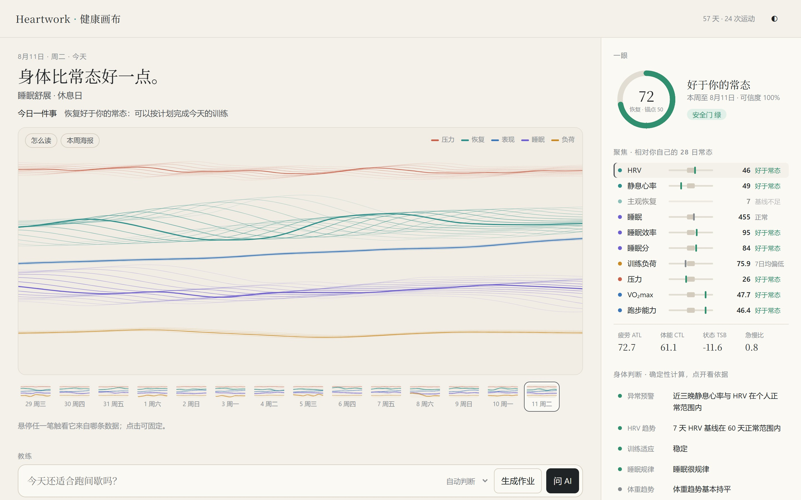
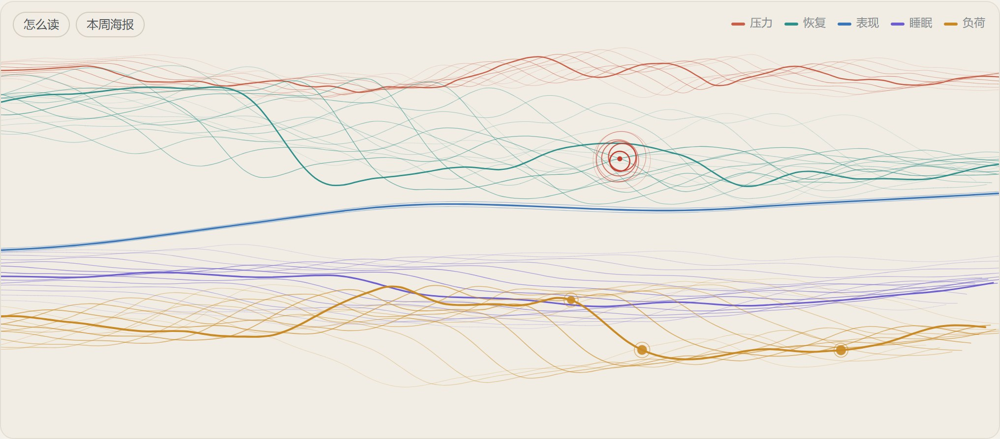
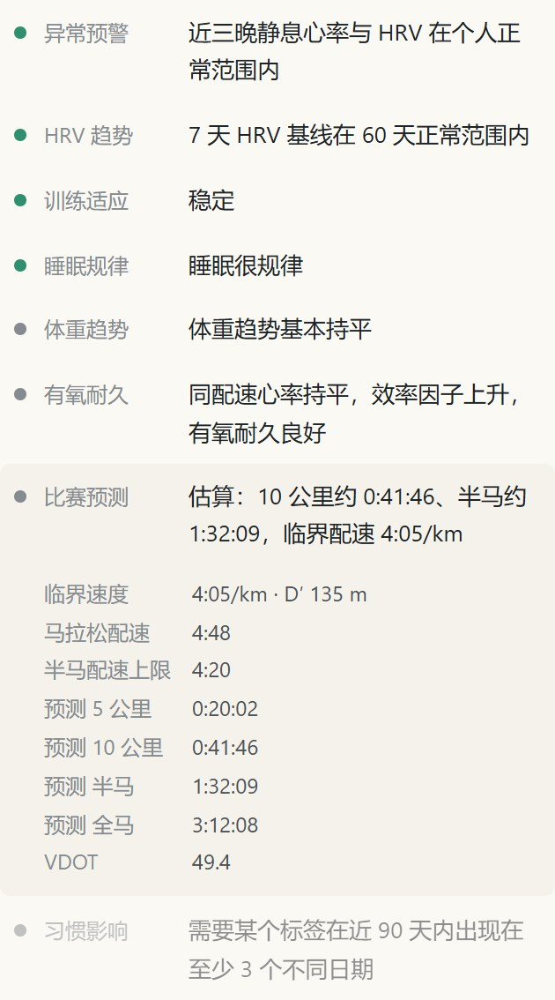
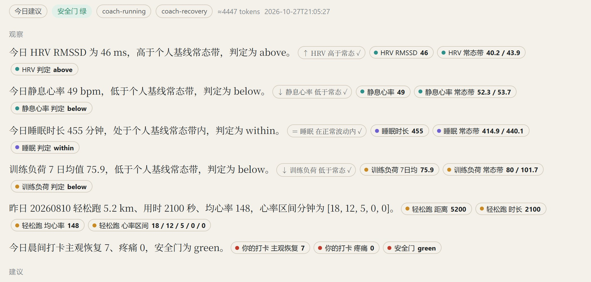

<p align="center">
  
</p>

<h3 align="center">以你自己为基准的训练与恢复系统</h3>

<p align="center">本地运行　·　证据核验的 AI 教练　·　网页与桌面　·　Apache-2.0</p>

<p align="center">
  <a href="#开始使用">开始使用</a>　·　<a href="#身体判断">身体判断</a>　·　<a href="#ai-教练">AI 教练</a>　·　<a href="#数据与隐私">数据与隐私</a>　·　<a href="CHANGELOG.md">更新记录</a>
</p>

<br>

Heartwork 读取手表和健康应用的数据，在本机把每一项指标放回你自己的常态中衡量。每天，它把身体数据画成一幅画布，给出当天最该做的一件事；你提问时，AI 教练只能依据这些数据作答，每一个数字都经过代码核对。

<picture>
  <source media="(prefers-color-scheme: dark)" srcset="docs/images/hero-dark.jpg">
  
</picture>

<br>

<table>
<tr>
<td width="33%" valign="top"><b>以你为准</b><br><br>基线来自你自己过去 28 天的数据，用稳健统计剔除偶发波动。只有偏离超过最小有意义变化，才算偏高或偏低。</td>
<td width="33%" valign="top"><b>凭证据说话</b><br><br>教练的每条结论都指向具体数据。数值、方向、引用由代码逐项核对，不通过的回答不会出现在你面前。</td>
<td width="33%" valign="top"><b>决定权在你</b><br><br>训练计划的修改权限分三档，由你设定。AI 只能读取档位，不能为自己提权；红黄灯也不能由模型降级。</td>
</tr>
</table>

## 每日画布

恢复、睡眠、负荷、压力、表现，各是一束丝带。状态好于常态时丝带收拢，偏离常态时散开缠绕；高心率训练是丝带上的结，疼痛记录是红色圆环。缺失的数据画成灰色虚线，不做插补。

画上每一笔都可追溯：悬停可见日期、数值、你的常态区间，以及这项数据来自哪个导入文件。画布可以逐日回看，一周七幅也可以导出成海报。

<picture>
  <source media="(prefers-color-scheme: dark)" srcset="docs/images/canvas-dark.jpg">
  
</picture>
<p align="center"><sub>节奏跑当天。负荷带上的结来自高心率区，恢复带上的红色圆环是当天的疼痛记录。示例数据为人工合成。</sub></p>

## 身体判断

在逐项对比常态之外，Heartwork 在本机计算一组身体判断。它们全部由确定性算法得出，方法来自已发表的研究，并作为证据提供给教练。



| 判断 | 方法 |
|---|---|
| 异常预警 | 夜间静息心率升高、HRV 下降，连续两晚出现即提示；最高级时安全门自动转黄 |
| HRV 趋势 | 7 天基线对比 60 天正常范围，并看日间波动 |
| 训练适应 | 稳定、应对良好、适应不良、疲劳累积、疑似功能性过量 |
| 睡眠规律 | 睡眠规律指数与社交时差 |
| 有氧耐久 | 同配速心率、效率因子、长距离心率解耦，按坡度校正 |
| 比赛预测 | 临界速度，Riegel 与 VDOT |
| 体重趋势 | 平滑后的真实变化，减重过快时提醒 |
| 习惯影响 | 饮酒、咖啡、晚餐等标签对次日恢复的影响，附置信区间 |
| 计划完成 | 对比日历上的计划课与实际训练 |

<br clear="right">

每天早上，这些判断与安全门汇总成「今日一件事」，可推送为桌面通知。这一步不调用任何模型。

<details>
<summary>方法出处</summary>

Alavi 2022、Mishra 2020（夜间异常预警）· HRV4Training / Plews 2013、Le Meur 2013（HRV 趋势与功能性过量）· Phillips 2017、Windred 2024（睡眠规律指数）· Minetti 2002（坡度校正配速）· Smyth 2022（心率解耦）· Smyth & Muniz-Pumares 2020（临界速度）· Garthe 2011（减重速率）。阈值与实现细节写在 `scripts/insights.py` 和 `scripts/streams.py` 的文档字符串中。

</details>

## AI 教练

教练可以直接调用模型作答：DeepSeek、OpenAI、Kimi、通义千问、Anthropic，或本机的 Ollama；已有 Claude、ChatGPT 订阅时，也可以通过本机已登录的 Claude Code、Codex CLI 作答。回答实时流式显示，并附用时与 token 用量。

模型看到的是一张编号事实表，引用时只写编号，由系统展开成原始数据再核对。核对不通过时，具体错误会退回给模型重写；仍不通过的回答不展示。

<picture>
  <source media="(prefers-color-scheme: dark)" srcset="docs/images/coach-dark.jpg">
  
</picture>
<p align="center"><sub>通过核验的回答。每条观察后附方向标签与证据；悬停证据，画布上对应的丝带随之高亮。</sub></p>

| 核验 | 规则 |
|---|---|
| 安全门 | 作答前，先依据近 14 天的疼痛、疾病、警示信号和夜间异常判定红黄绿灯。红灯只能建议就医，黄灯不得加量 |
| 签名作业 | 上下文以本机密钥签名，作答期间数据若有变化，回答即作废 |
| 数值 | 结论中的每个数字都必须出现在所引数据中；说某项"缺失"时，所引数据必须为空 |
| 方向 | "偏高""下降"等判断必须与确定性基线一致 |
| 分层 | 实验性模型的结果不能单独支撑训练处方 |
| 评测 | 20 个固定场景回放，覆盖伪造数值、方向说反、编造数字、黄灯加量等，全部通过才能发布 |

### 权限档位

| 档位 | 教练可以做什么 |
|---|---|
| 保守 | 只观察和提醒，不提计划修改 |
| 标准（默认） | 可以提出计划修改，每一条都由你确认后生效 |
| 激进 | 绿灯、有原始数据证据、置信度达标、72 小时内未自动调整过，四项同时满足时可直接修改计划；原计划保留，7 天内可一键撤销 |

档位只能在本机网页或命令行中修改。

## 数据与隐私

- 数据保存在本机工作区 `~/.heartwork`，与代码仓库分开。存储使用单个 SQLite 文件，网页、MCP 与桌面版同时写入互不覆盖。
- 网页只监听 `127.0.0.1`，校验请求来源，不加载外部资源。
- 只有填写 API Key 后才会连接 intervals.icu，且只读取你本人的数据；把计划课写回日历必须由你亲自确认。
- 使用云端模型时，当次问题所需的数据会发送给你选择的服务商；选择 Ollama 则全程不出本机。所有 Key 只存于工作区，任何界面都不回显。
- 每个导入文件都留有记录：文件名、SHA-256 与写入条数。

## 开始使用

需要 Python 3.9 或更高版本，核心不依赖任何第三方库。

```bash
python scripts/heartwork.py init --demo     # 载入 8 周合成示例数据
python scripts/heartwork.py web             # 打开 http://127.0.0.1:8765
python scripts/heartwork.py desktop         # 或以桌面窗口打开（需先 pip install pywebview）
```

使用自己的数据时，去掉 `--demo` 初始化空工作区，再用以下任一方式导入：

```bash
python scripts/heartwork.py import ~/Downloads/activities/ export.zip daily.csv   # 文件导入，也可拖进网页
python scripts/heartwork.py intervals --api-key <key>                            # 绑定 intervals.icu
python scripts/heartwork.py intervals sync                                       # 同步健康数据、训练与计划课
python scripts/heartwork.py profile --hr-max 188 --hr-rest 48                    # 填写最大心率后计算心率区间
```

配置 AI 教练：

```bash
python scripts/heartwork.py model --provider deepseek --api-key <key>   # 或 openai / anthropic / ollama / claude-cli / codex-cli
python scripts/heartwork.py model --test
python scripts/heartwork.py coach "今天适合跑间歇吗"
```

<details>
<summary>支持的文件格式</summary>

| 格式 | 读取内容 |
|---|---|
| `.fit` | 时间、距离、心率与海拔的逐秒数据（标准库解析，不依赖 SDK） |
| `.gpx` / `.tcx` | 轨迹时间、距离、海拔、心率 |
| `.csv` | 每日指标，中英文表头均可识别：日期、HRV、静息心率、睡眠时长、体重等 |
| Apple Health `export.xml` / `.zip` | 静息心率、体重、睡眠、体能训练 |

Apple Health 记录的 HRV 为 SDNN，与 Heartwork 使用的 RMSSD 口径不同，导入时自动跳过。

</details>

<details>
<summary>接入 Claude Code、Codex、Gemini 等 AI agent</summary>

```bash
claude mcp add heartwork -- python scripts/heartwork.py mcp        # Claude Code
codex mcp add heartwork -- python scripts/heartwork.py mcp         # Codex
gemini mcp add heartwork python scripts/heartwork.py mcp           # Gemini CLI
```

Claude Desktop、DeepSeek Harness、ChatGPT 的配置见 [integrations/](integrations/)。agent 通过 `start_coach_job` 获取签名上下文，通过 `submit_coach_response` 提交回答，核验规则与内置教练相同。MCP 还提供 `body_insights`、`morning_brief`、`sync_intervals` 等只读工具；修改计划、调整档位、写回日历不对 agent 开放。

8 项专项技能（恢复、疼痛、跑步、计划、睡眠、减重、体态、复盘）可以安装到 agent 的技能目录：

```bash
python scripts/heartwork.py install-skills --target claude   # 也支持 dsh / agents / gemini
```

不支持 MCP 的 AI 也可以使用：在网页中生成作业，把提示词交给它，再把回答贴回来核验。

</details>

<details>
<summary>全部命令</summary>

```bash
python scripts/heartwork.py status                          # 工作区概况
python scripts/heartwork.py insights                        # 身体判断
python scripts/heartwork.py brief --notify                  # 今日一件事，并推送桌面通知
python scripts/heartwork.py brief --schedule 07:30          # 生成每日定时推送的系统命令
python scripts/heartwork.py checkin --recovery 6 --pain 2 --tags 饮酒,晚餐晚 --note "右小腿紧"
python scripts/heartwork.py coach "跑完腿沉，明天怎么练"
python scripts/heartwork.py report                          # 生成本周 Obsidian 周报告
python scripts/heartwork.py suggestions                     # 待确认的建议
python scripts/heartwork.py decide <key> --accept
python scripts/heartwork.py plan-apply <key> --text "周四间歇改为轻松跑" --confirm
python scripts/heartwork.py autonomy autonomous --confirm   # conservative / balanced / autonomous
python scripts/heartwork.py undo <key>                      # 撤销一次自动调整
python scripts/heartwork.py intervals push --date 2026-11-02 --name "轻松跑" --minutes 40 --confirm
python scripts/heartwork.py eval                            # 行为评测
```

所有命令都可以用 `--home <目录>` 或环境变量 `HEARTWORK_HOME` 指定工作区。

</details>

## 适用范围

Heartwork 用于个人趋势记录、运动教育与研究，不提供医学诊断、治疗或紧急决策。出现胸痛、晕厥、无法承重等情况，请立即就医。

身体判断描述的是相对你个人常态的统计偏移，异常预警可能由饮酒、旅行或高强度训练引起；比赛预测假定数据中包含接近全力的成绩。仓库中的示例数据全部为人工合成。

完整说明见 [PRIVACY](PRIVACY.md)、[SECURITY](SECURITY.md)、[DISCLAIMER](DISCLAIMER.md) 与 [方法与边界](08_方法与边界/)。本仓库同时是一个 Obsidian 库，入口为 [00_首页](00_首页.md)。

<details>
<summary>项目结构</summary>

```text
scripts/            基线、导入与活动分析、身体判断、intervals.icu 同步、晨报、
                    教练运行层、AI 内核、API、命令行、MCP、网页与桌面
scripts/web/        本机网页（单文件，无外部资源）
skills/             8 项专项技能与路由表
integrations/       各 AI 客户端的接入说明
schemas/            周输入、Context v2、Response v2
examples/           合成示例
tests/              算法、导入、教练安全、授权、溯源、MCP 与网页测试
01–08_*/            Obsidian 模板、周报告与方法文档
```

</details>

## 许可

代码与文档以 [Apache License 2.0](LICENSE) 发布。科学方法、第三方名称与引用归各自权利人所有。
