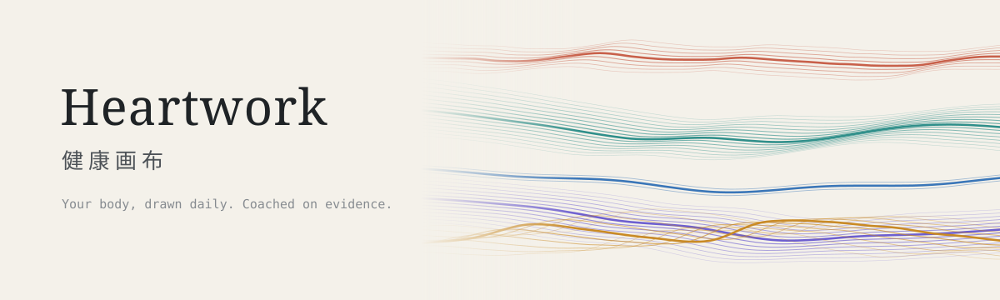
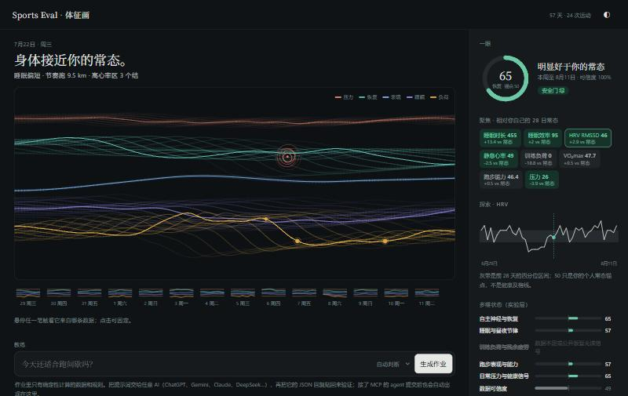
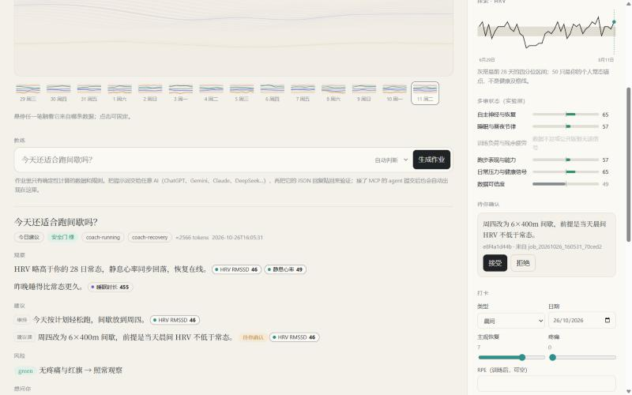

<p align="center">
  
</p>

<p align="center"><b>以你本人为基准的健康画布，与只依据证据发言的 AI 教练。</b></p>

<p align="center"><sub>本地运行 · 零依赖 · 支持 Claude / ChatGPT / Gemini / Codex / DeepSeek · Apache-2.0</sub></p>

<p align="center">
  <a href="#开始使用">开始使用</a> ｜ <a href="#接入-ai">接入 AI</a> ｜ <a href="#有据可依的-ai-教练">证据机制</a> ｜ <a href="#授权由你设定">授权档位</a> ｜ <a href="CHANGELOG.md">更新记录</a>
</p>

Heartwork 读取你从手表和健康应用导出的数据，在本机算出每项指标相对你个人常态的位置，每天生成一幅画布，再把经过确定性处理的上下文交给你选用的 AI。AI 的每条结论都必须指向具体数据，并通过代码核验。训练计划的修改权限由你设定。

<p align="center">
  
</p>
<p align="center"><sub>8 周合成示例数据。7 月 22 日节奏跑后，负荷带上出现了高心率区的结；红色圆环是当天的疼痛记录。</sub></p>

## 每日画布

恢复、睡眠、负荷、压力、表现，各是一束丝带。状态好于个人常态时，丝带收拢成束；偏离常态时，丝带散开、相互缠绕。高心率训练显示为结，疼痛与不适标为红色圆环。缺失的数据保持灰色虚线，不做插补。

每一笔都可以追溯：悬停即可看到日期、数值、个人常态区间，以及写入这项数据的导入文件和它的 SHA-256。画布可以逐日回看，也可以把一周七幅导出为海报。

## 以你为基准

Heartwork 不用人群平均值评判个人。

- **滚动基线**：近 7 天均值对比此前 28 天的中位数，两个窗口互不重叠。
- **稳健尺度**：离散度采用 MAD，个别异常值不会扭曲基线。
- **最小有意义变化**：偏离超过 SWC 才标记为偏高或偏低，日常波动保持中性。
- **HRV 对数化**：RMSSD 先换算为 lnRMSSD，再参与比较。
- **训练负荷**：用 ATL、CTL、TSB 描述疲劳、体能与当前状态；没有设备记录的训练可以用 sRPE（RPE × 分钟）补录。

这些计算只在 Python 里做一次，画布、AI 上下文和周报告用的是同一份结果。

## 有据可依的 AI 教练

Heartwork 不内置模型，而是给你选用的 AI 定下一套必须遵守的规则。

| 机制 | 作用 |
|---|---|
| 安全门 | 调用模型之前，先根据近 14 天的疼痛、疾病和警示信号判定红、黄、绿灯。红灯只允许建议就医，黄灯禁止加量 |
| 签名作业 | 上下文用本机密钥签名；AI 作答期间数据如有变化，提交时会被判为过期 |
| 证据核验 | 每条结论附带 JSON Pointer 和观测值，代码逐项比对，数值不一致即拒绝 |
| 方向核验 | 说到「偏高」「下降」这类趋势时，必须声明方向，且要与确定性基线的判定一致 |
| 分层约束 | 原始数据、确定性指标、实验模型分层存放；实验层不能单独支撑训练处方 |
| 行为评测 | 17 个固定场景回放，包括伪造数值、方向说反、黄灯下自动改计划等；全部判定正确才能发布 |

没通过核验的回答不会展示给你。

<p align="center">
  
</p>
<p align="center"><sub>通过核验的回答。每条结论后面附有方向标签和证据，悬停证据时，画布上对应的丝带会高亮。右栏是授权档位。</sub></p>

## 授权由你设定

| 档位 | AI 教练的权限 |
|---|---|
| 保守 | 只观察和提醒，不提计划修改；每条建议都要有原始数据支撑 |
| 标准（默认） | 可以提计划修改，每一条都要你确认后才生效 |
| 激进 | 同时满足四个条件时，可以直接修改计划：安全门为绿灯、有原始数据证据、置信度达标、72 小时内没有自动调整过。每次修改都保留原计划，7 天内一键撤销 |

档位只能在本机网页或命令行里修改。AI 通过 MCP 只能读取档位，不能给自己提权。安全门在所有档位下都有效。

## 数据留在本机

- 工作区默认在 `~/.heartwork`，和代码仓库分开存放。
- 网页只监听 `127.0.0.1`，会校验请求来源，不加载任何外部资源。
- 零第三方依赖，不含任何厂商账号或数据抓取接口。
- 每个导入的文件都记在 `imports.json` 里，包括文件名、SHA-256 和写入的条数。

## 开始使用

需要 Python 3.9 或更高版本。在仓库根目录运行：

```bash
python scripts/heartwork.py init --demo   # 载入 8 周合成数据
python scripts/heartwork.py web           # 打开 http://127.0.0.1:8765
```

要用自己的数据，就去掉 `--demo` 初始化一个空工作区，然后把文件拖进网页的「导入」区域，或者用命令行导入：

```bash
python scripts/heartwork.py import ~/Downloads/activities/ export.zip daily.csv
python scripts/heartwork.py profile --hr-max 188 --hr-rest 48   # 填写最大心率后才会计算心率区间
```

| 格式 | 读取内容 |
|---|---|
| `.fit` | 开始时间、时长、距离、平均心率、逐秒心率（用标准库解析，不依赖 SDK） |
| `.gpx` / `.tcx` | 轨迹时间、距离、心率扩展 |
| `.csv` | 每日指标，中英文表头都能识别：`date/日期`、`hrv`、`静息心率`、`睡眠时长`、`体重` 等 |
| Apple Health `export.xml` 或 `.zip` | 静息心率、体重、睡眠（按醒来那天归属）、体能训练 |

Apple Health 记录的 HRV 是 SDNN，和 Heartwork 使用的 RMSSD 口径不同，导入时会自动跳过。

## 接入 AI

```bash
claude mcp add heartwork -- python scripts/heartwork.py mcp        # Claude Code
codex mcp add heartwork -- python scripts/heartwork.py mcp         # Codex
gemini mcp add heartwork python scripts/heartwork.py mcp           # Gemini CLI
```

Claude Desktop、DeepSeek Harness、ChatGPT 的配置方法见 [integrations/](integrations/)。接入后可以直接提问，例如「今天适合训练吗」。AI 会先调用 `start_coach_job` 获取上下文，再调用 `submit_coach_response` 提交回答；通过核验的回答会同步显示在网页里。

| MCP 工具 | 作用 |
|---|---|
| `status` / `get_profile` / `get_autonomy` | 查看工作区概况、个人档案、授权档位 |
| `import_files` / `log_event` | 导入文件；记录晨间恢复、RPE、疼痛 |
| `weekly_report` | 生成 Obsidian 周报告 |
| `start_coach_job` | 生成签名作业，包含上下文、规则、相关技能和回复模板 |
| `submit_coach_response` | 验证签名，检查数据是否有变化，逐项核验证据 |
| `list_pending_suggestions` / `run_eval` | 查看待确认的建议；运行行为评测 |

8 项专项技能（恢复、疼痛、跑步、计划、睡眠、减重、体态、复盘）可以装进 agent 的技能目录：

```bash
python scripts/heartwork.py install-skills --target claude   # 也支持 dsh / agents / gemini
```

不支持 MCP 的 AI（网页版 ChatGPT、Gemini、DeepSeek 等）也能用：在网页里提问，复制提示词发给 AI，再把它的回复粘贴回来做核验。

## 命令

```bash
python scripts/heartwork.py status                          # 工作区概况
python scripts/heartwork.py checkin --type morning_checkin --recovery 6 --pain 2 --note "右小腿紧"
python scripts/heartwork.py report                          # 生成本周 Obsidian 周报告
python scripts/heartwork.py suggestions                     # 待确认的建议
python scripts/heartwork.py decide <key> --accept
python scripts/heartwork.py plan-apply <key> --text "周四间歇改为轻松跑" --confirm
python scripts/heartwork.py autonomy autonomous --confirm   # 授权档位：conservative / balanced / autonomous
python scripts/heartwork.py undo <key>                      # 撤销一次自动调整
python scripts/heartwork.py eval                            # 行为评测
```

所有命令都可以用 `--home <目录>` 或环境变量 `HEARTWORK_HOME` 指定工作区。

## 适用范围

Heartwork 用于个人趋势记录、运动教育与研究，不提供医学诊断、治疗或紧急决策。如果出现胸痛、晕厥、无法承重等情况，请立即就医。

- 多维状态和变化候选属于实验层，只描述统计上的偏移。
- 设备负荷、心率区 TRIMP、sRPE 三种口径的尺度不同，系统会标注口径，但不做换算。
- 心率区间只在填写了最大心率或区间边界后才会计算。
- 仓库里的示例数据全部是人工合成的。

完整规则见 [PRIVACY](PRIVACY.md)、[SECURITY](SECURITY.md) 和 [DISCLAIMER](DISCLAIMER.md)，方法说明见 [08_方法与边界](08_方法与边界/)。本仓库同时也是一个 Obsidian 库，入口是 [00_首页](00_首页.md)。

## 项目结构

```text
scripts/            核心实现：基线、导入、教练运行层、API、命令行、MCP、网页服务
scripts/web/        本机网页（单文件，不依赖外部资源）
skills/             8 项专项技能与路由表
integrations/       Claude / ChatGPT / Gemini / Codex / DeepSeek Harness 接入说明
schemas/            周输入、Context v2、Response v2
examples/           合成示例
tests/              算法、导入、教练安全、授权、溯源、MCP 与网页测试
01–08_*/            Obsidian 模板、周报告与方法文档
```

## 许可

代码与文档以 [Apache License 2.0](LICENSE) 发布。科学方法、第三方名称和引用归各自的权利人所有。
